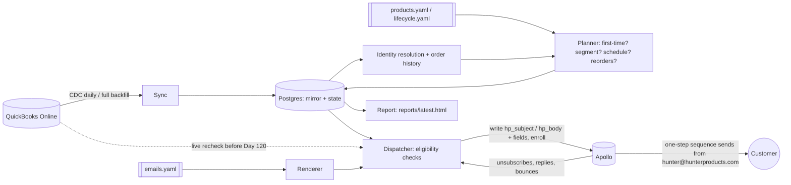

# Architecture and design decisions

## 1. Feasibility findings (checked November 2026)

### Apollo API
| Need | Supported? | How |
|---|---|---|
| Create / update contacts | Yes | `POST /contacts` with `run_dedupe: true`, `PUT /contacts/{id}`. Dedupe is OFF by default, so we search by email first and always pass `run_dedupe`. |
| Custom fields | Yes | `typed_custom_fields` keyed by field id; fields listed via `GET /fields` and created via `POST /fields`. |
| Enroll in a sequence | Yes | `POST /emailer_campaigns/{id}/add_contact_ids`. 0 credits. Master API key required. 600 calls/hour. |
| Pause / remove / finish | Yes | `POST /emailer_campaigns/remove_or_stop_contact_ids`, mode `stop`, `remove` or `mark_as_finished`. 0 credits. Master key. 600/hour. |
| Engagement status | Partly | `POST /emailer_messages/search` (open/reply/bounce), plus `email_unsubscribed` and `email_status` on the contact. Polled; Apollo does not push events to us. |
| Per-contact timing inside a sequence | **No** | Step delays are fixed and count from enrollment. Apollo cannot do "4 days after delivery", "60 to 90 days depending on product", or "only if no reorder". |
| Prevent stacking on cold sequences | Yes | `sequence_active_in_other_campaigns: false` on enrollment, plus our own pre-check. |

Existing account facts that shaped the design:
* Sending mailbox `hunter@hunterproducts.com` (id `69b4578fbbbdb70011b7044a`) is connected. Real customers get mail from the main domain, not the cold `hunterproducts.co` domain.
* Seven sequences already run (Tier A Reactivation, TTM, Technoprobe, Tech Briefs x2, Website Visitors x2). New customers who are also in one of those are deferred, not double-mailed.
* Sequences created through the API come up needing manual approval, so the four lifecycle sequences get approved once in the UI.

### QuickBooks Online API
| Need | Supported? | Notes |
|---|---|---|
| Customers, invoices, sales receipts, credit memos, refunds, items | Yes | SQL-style `query` endpoint, 1,000 rows per page. |
| Incremental changes incl. deletes | Yes | Change Data Capture (`/cdc`) returns full records changed in the **last 30 days**, deletes flagged `status: Deleted`. |
| Webhooks | Yes | Not needed: day-level timing doesn't justify a public endpoint. Daily CDC plus a live query before the Day 120 email covers it. |
| Rate limits | 500 req/min and 10 concurrent per company | This job makes a few dozen calls a day. |
| Delivery date | **No** | Only `ShipDate`, `TrackingNum`, `ShipAddr`. Delivery is estimated; Email 1 never says the order arrived. |
| Auth | OAuth 2.0 | Access token 1 hour. Refresh token **rotates** and must be saved on every refresh; hard maximum lifetime 5 years. |
| Voids | Indirect | A voided invoice keeps its record, total becomes 0 and the private note says "Voided". |

### Low-code (n8n / Make)
Feasible for the plumbing, not recommended for the core. The rules that matter most (cross-record identity, back-dated imports, refunds, reorder typing, stale-send protection, idempotent recovery after a crash) need versioned logic and the 67 automated tests in `tests/`. n8n is still a fine place for the scheduler if you'd rather not use GitHub Actions: an n8n Cron node can call `hunter-retention run` on a box.

## 2. Architecture

**The backend owns the schedule. Apollo only sends.**

* Four one-step Apollo sequences (`e1`..`e4`), each one automatic email with `wait 0 days`, subject `{{hp_subject}}`, body `{{hp_body}}`.
* On the day a touch is due, the dispatcher re-checks everything, renders the copy from the customer's real order, writes it into the contact's custom fields and enrolls them. Apollo sends that day inside its schedule window.
* Nothing waits inside Apollo for weeks, so a reorder, refund or unsubscribe can never "miss" a removal call.
* All copy lives in `content/emails.yaml` under version control. Apollo never holds stale or unapproved text.

Alternative considered: one multi-step Apollo sequence per segment, removing contacts on reorder. Rejected: fixed step delays break delivery-based and replenishment timing, it can't do a last-second QuickBooks check, and a missed removal call means a wrong email.

Cost: GitHub Actions (free tier) + Neon or Supabase Postgres (free tier) + Apollo (existing plan, 0 credits used). Intuit counts API reads toward its free Builder tier; this job's volume is tiny.

## 3. Segmentation rules

Line items map to `family` (micro_metallizer, carbitron, micro_jet) and `role` (equipment, consumable, prep, accessory) through `config/products.yaml`, built from the live 123-item QuickBooks list. 122 items map cleanly; `TS3050 Power Supply` is deliberately unmapped until you confirm which system it belongs to.

| Segment | Who | Rule |
|---|---|---|
| A Micro-Metallizer | Pens, kits, power supplies | any Micro-Metallizer equipment or pen line |
| B Carbitron 300 | Bought a Carbitron 300 | TS3037 / TS3037-110 |
| C Micro-Jet 200 | Bought a Micro-Jet or blast cabinet | AB2000 / AB2005 / AB2017 |
| D Consumables only | Electrodes, nozzles, media, parts, degreaser or cables without a system | everything else that is classified |
| E Unclassified | Nothing in the order maps | never emailed; review queue + alert |

* Subsegments for A: gold, nickel, tin, silver, copper, other, multi (2+ metals), general (kit only; application is never guessed).
* Mixed orders: priority `B > C > A > D`. A Carbitron buyer who also bought pens gets the Carbitron sequence only; the pens are recorded as a secondary segment. One track per customer, so nobody gets two sequences.
* An order with a known product plus an unknown SKU still enrolls; the unknown SKU goes to the review queue.

## 4. First-time customer logic

1. Customers are grouped into accounts: sub-customers/jobs roll up to their parent; records sharing an email merge; records with the same normalized company name and same company domain merge. Gmail-type domains never merge companies.
2. A qualifying purchase is an active (not voided/deleted) invoice or sales receipt with more than $0 of product lines, not fully refunded (credit ≥ 90% within 120 days). Shipping, tax, tariff and fee lines don't count. $0 samples don't count.
3. Invoices within 2 days of the first one form one "first purchase".
4. First-time = the account's earliest qualifying purchase is on/after `program_start_date`. Creation dates are never used.
5. A new contact whose company domain already bought from us is **held for review** (configurable).
6. Billing-only addresses are held for review rather than emailed. Your live invoices show this is common: the three most recent invoices went to `cl_smajda@fischione.com` (a person), `aesculap_ap@aesculapusa.com` and `apforestgrove@ttmtech.com` (AP inboxes). The patterns in `settings.yaml` catch both AP styles. Expect a share of new customers to land in `review` for a buyer/engineer email; add it with `review --resolve ID --action enroll --email person@company.com`, or put the person's address first in the QBO customer's email field (QBO accepts several, comma-separated) and the hold releases on the next run.

Everything is recomputed from the QuickBooks mirror every run, so edits, voids, merges and late imports are picked up automatically. If emails have already gone out and the history changes underneath (e.g. an older invoice is imported), the track stops and a review item is created instead of sending something inconsistent.

## 5. Timing

* Anchor = ShipDate + transit (4 days domestic, 10 international). No ShipDate: order date + fulfillment lag + transit.
* e1 anchor+4, e2 anchor+30, e3 replenishment (60 to 90), e4 anchor+120.
* Replenishment = median observed days from first purchase to first same-line consumable reorder across your whole history (when 8+ examples exist), else the configured default, scaled up for large first orders, clamped to 60..90.
* Every touch has a window. If it can't go out inside the window (outage, held record, late classification), it is skipped, never sent late.

## 6. Reorder detection and suppression

Every later order is typed: `any_purchase`, `same_family`, `consumable_replenishment`, `new_equipment`.

| Touch | Suppressed by (default) |
|---|---|
| e1 setup, e2 tips | nothing (still useful after a reorder) |
| e3 replenishment | `consumable_replenishment` of the same product line (D: `same_family`) |
| e4 personal check-in | `any_purchase` |

e3 and e4 re-query QuickBooks for that customer immediately before sending. If a reorder lands after enrollment but before Apollo sends, the enrollment is stopped (`recall`).

## 7. Database

Postgres (SQLite for tests). Tables: `qbo_customers`, `qbo_items`, `qbo_txns`, `qbo_txn_lines` (mirror); `tracks` (one per account), `touches` (one per email, unique per track), `engagement`, `suppressions`, `review_queue`, `events` (audit log), `runs`, `approvals`, `oauth_tokens`, `apollo_fields`, `sync_state`.

## 8. Safety

* Three modes: `dry_run` (default, no Apollo writes), `sandbox` (real Apollo, every email redirected to an internal address with a `[TEST]` subject), `live`.
* Live needs **all three**: `mode: live`, env `HP_ALLOW_LIVE_SEND=true`, and a recorded `approve-production` with the phrase `SEND REAL EMAILS`.
* Any `[[VERIFY ...]]` left in copy blocks that email in live mode and alerts.
* A touch is claimed (`enrolling`) and committed before the Apollo call; after a crash the next run checks Apollo before retrying.
* QuickBooks failure stops the run before anything is sent.
* Frequency caps: 7 days between emails, max 2 per 30 days per address across all records.
* Replies stop the sequence (a human takes over). Unsubscribes and bounces go to a permanent suppression list.
* 10% random holdout (configurable) so revenue lift can be measured instead of assumed.
